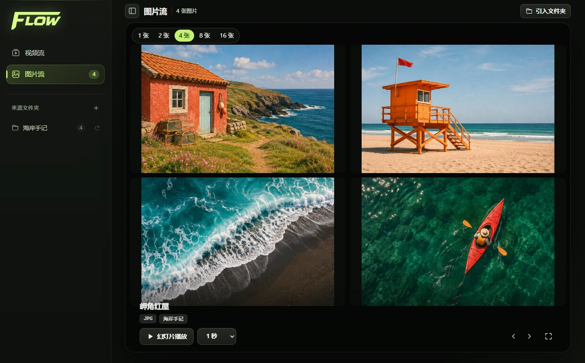
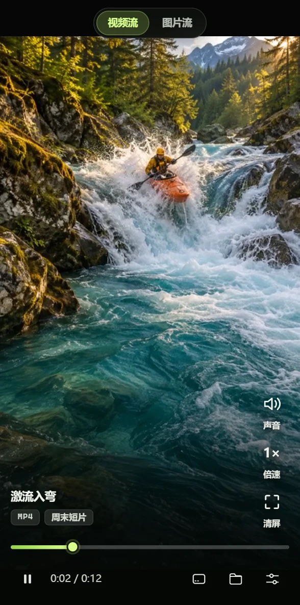
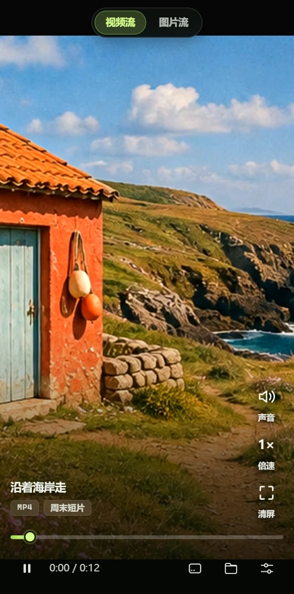

# Flow

Flow 让你在浏览器里快速翻完一整个文件夹的素材。

**图片流**一次最多预览 16 张照片，

**视频流**让你在手机上像刷 TikTok 一样，上下滑动观看自己拍的短片。选好电脑或 NAS 上的目录，Flow 会连同子文件夹一起扫描，原文件仍留在原处。

### 一次扫过一组照片

同屏可选 1、2、4、8 或 16 张。照片多时先用网格粗看，滚一下鼠标就翻到下一组。遇到想看细节的照片，点开大图，关闭后还在刚才那一组。想让照片自己翻页，可以开启幻灯片并设置间隔。



### 上滑就是下一条短片

手机上一条短片占一屏，上滑切到下一条，下滑回看上一条。点画面可以暂停，长按可以临时加速。坐到电脑前，同一份素材也能用滚轮或上下方向键连续翻看。

| 当前短片 | 上滑后的下一条 |
| --- | --- |
|  |  |

*以上均为 Flow 的实际界面截图。照片和短片画面均为本 README 生成的演示素材。*

## 快速开始

### Windows

安装 Python 3.10 或更高版本，在项目目录打开 PowerShell，运行以下命令。

```powershell
python .\server.py
```

兼容播放和内封字幕需要 FFmpeg 和 ffprobe。Windows 上可将这两个程序加入 `PATH`，或放到项目的 `vendor/ffmpeg/windows/` 目录。

打开 [本机播放器](http://127.0.0.1:28888)，按素材类型切换到「图片流」或「视频流」，再点击「引入文件夹」。可以逐级浏览，也可以粘贴本地路径或 NAS 共享路径。选好目录后，点击「引入此文件夹」。首批素材入库后即可开始浏览。

要让同一局域网里的手机访问，可以用下面的命令启动。将示例中的目录替换为自己的媒体目录，再用手机打开 `http://电脑的局域网IP:28888`。

```powershell
python .\server.py --host 0.0.0.0 --root "D:\视频"
```

`--root` 可以重复传入，用来限定允许浏览的目录。索引默认保存在项目的 `data` 目录，通过 `--data` 可以指定其他位置。

### NAS / Docker

#### 一键启动

在 NAS 终端运行下面的命令。先把 `/volume1/video` 换成实际存放视频和图片的目录。`/volume1/docker/flow/data` 用来保存 Flow 的索引，可以按需修改。

```sh
mkdir -p "/volume1/docker/flow/data" && docker run -d \
  --name flow \
  --restart unless-stopped \
  -p 28888:28888 \
  --mount "type=bind,source=/volume1/video,target=/media,readonly" \
  --mount "type=bind,source=/volume1/docker/flow/data,target=/data" \
  lqqai/flow:latest
```

#### 使用 Docker Compose

在 NAS 上新建一个目录，将下面的内容保存为 `compose.yaml`。把 `/volume1/video` 换成 NAS 上实际的媒体目录。镜像仓库为 [Docker Hub 上的 lqqai/flow](https://hub.docker.com/r/lqqai/flow)。

```yaml
services:
  flow:
    image: lqqai/flow:latest
    restart: unless-stopped
    ports:
      - "28888:28888"
    volumes:
      - type: bind
        source: /volume1/video
        target: /media
        read_only: true
        bind:
          create_host_path: false
      - flow-data:/data

volumes:
  flow-data:
```

在该目录拉取镜像并启动服务。使用指定版本时，把 `latest` 换成对应标签。

```sh
docker compose pull
docker compose up -d
```

#### 在 NAS 界面填写文件夹映射

通过 NAS 的 Docker 管理界面创建容器时，按下表填写文件夹映射。宿主机路径是示例，可换成你自己的目录。请先创建索引目录，并给容器读写权限。

| NAS 上的文件夹 | 容器路径 | 权限 | 用途 |
| --- | --- | --- | --- |
| `/volume1/video` | `/media` | 只读 | 视频、图片和外挂字幕 |
| `/volume1/docker/flow/data` | `/data` | 读写 | 持久保存 SQLite 索引 |

上面的 Compose 示例用 Docker 命名卷 `flow-data` 保存索引，也可用表中的 NAS 文件夹映射到 `/data`。

打开 `http://NAS的局域网IP:28888`，在「引入文件夹」中选择容器内的 `/media` 或其子目录。服务适合部署在可信局域网，能访问它的设备都可以选择媒体目录。

## 其他播放与片库操作

| 操作 | 使用方式 |
| --- | --- |
| 桌面全屏 | 点击播放器右下角的全屏按钮，移动鼠标可唤出控件，按 Esc 返回。 |
| 连播分段视频 | 在「播放设置」开启「拼接播放」，同一子目录里的多个片段会共用一条进度条。 |
| 更新索引 | 文件有增删或移动后，点击来源文件夹旁的重新扫描按钮，也可以再次引入同一目录。 |

## 文件格式与字幕

- **视频**支持 MP4、MKV、MOV、AVI 和 TS。**图片**支持 JPG、JPEG、PNG、WebP、GIF、AVIF 和 BMP。扩展名大小写均可。
- **外挂字幕**放在视频旁边，使用相同的文件名。例如 `电影.mkv` 可以搭配 `电影.srt` 或 `电影.zh-CN.ass`。支持 SRT、VTT、ASS 和 SSA。
- **内封字幕**会在没有匹配外挂字幕时自动读取，优先选择中文文本轨。PGS 图形字幕目前需要搭配外挂文本字幕。
- **音视频兼容**优先播放原文件。遇到浏览器无法解码的 DTS、AC-3 等音轨时，Flow 会尝试转换为 AAC 双声道。画面无法解码时可切换 FFmpeg 兼容播放，实时转码的速度取决于服务器性能。Docker 镜像已包含 FFmpeg 和 ffprobe。

## 开发时自动刷新

Windows 本地开发可加上 `--reload` 启动。

```powershell
python .\server.py --reload
```

使用 Docker Compose 2.22 或更高版本时，可启用文件监听。

```sh
docker compose -f compose.yaml -f compose.reload.yaml up --build --watch
```

修改 `web/` 下的页面会自动刷新浏览器。修改 `server.py` 或 `flow/` 下的 Python 代码会重启服务并刷新页面。
